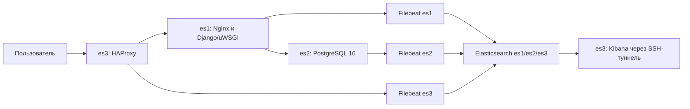

# ДЗ07 — централизованный сбор логов в Elasticsearch

Цель — отказоустойчивое хранение журналов серверов и визуализация для диагностики.
Реализован кластер Elasticsearch 8.19.0 из трёх узлов в Selectel, сбор через
Filebeat и просмотр в Kibana. Логи собираются только с серверов этого проекта.
Исходники приложения и инфраструктурные подходы переиспользованы из ДЗ01–ДЗ06;
работающие стенды предыдущих заданий не требуются.

## Архитектура



| ВМ | Дополнительные сервисы | Ресурсы | Диск |
| --- | --- | --- | --- |
| es1 | Nginx, Django/uWSGI | 2 vCPU, 8 ГиБ RAM | 20 ГиБ SSD |
| es2 | PostgreSQL 16 | 2 vCPU, 8 ГиБ RAM | 40 ГиБ SSD |
| es3 | HAProxy, Kibana | 2 vCPU, 8 ГиБ RAM | 20 ГиБ SSD |

На каждой ВМ работают Elasticsearch с ролями master/data/ingest и Filebeat.
Узлы размещаются в ru-9a на разных физических хостах посредством anti-affinity.
Одна основная копия и одна реплика индексов, большинство 2/3 для выбора master
позволяют Elasticsearch пережить потерю одной ВМ. Отказ всего ЦОД не покрывается;
приложение, база и Kibana собственных реплик не имеют.

Сеть — 10.77.0.0/16, адреса узлов — 10.77.1.10, 10.77.2.10, 10.77.3.10.
Запрос проходит HAProxy:80 → Nginx:8081 → uWSGI:8080 → PostgreSQL:5432.
Elasticsearch:9200/9300 доступен внутри группы безопасности; SSH:443 ограничен
адресами /32 оператора. Kibana:5601 слушает localhost. HTTP и транспорт
Elasticsearch используют TLS и проверку собственного центра сертификации.
Filebeat имеет отдельную роль записи, Kibana использует kibana_system.

`discovery.seed_hosts` содержит три приватных адреса.
`cluster.initial_master_nodes` используется только при первом формировании
кластера, затем удаляется. Данные хранятся на дисках ВМ и удаляются вместе со стендом.

Filebeat собирает journald, журналы Elasticsearch и файлы Nginx, PostgreSQL,
HAProxy. Очередь на диске ограничена 512 МБ; отправка распределяется между тремя
HTTPS endpoint. Шаблон `logs-otus-*` задаёт реплику; ingest pipeline классифицирует
события и разбирает Nginx. Политика жизненного цикла индексов (ILM) удаляет их
через семь дней от создания. Ежедневные индексы не используют rollover.

## Соответствие заданию

| Требование | Реализация и подтверждение |
| --- | --- |
| Три узла Elasticsearch | [Terraform Selectel](terraform-selectel/), [состояние кластера](docs/verification.json) |
| Логи web, БД и балансировщика | [Настройка серверов](scripts/remote/setup.py), Filebeat на трёх ВМ |
| Шаблоны и обработка | [Настройка Elasticsearch](scripts/remote/api.py), pipeline, ILM, шаблон индекса |
| Поступление логов | [Примеры событий](docs/verification.json), [HTTP-проверки](docs/http-check.json) |
| Визуализация | [Kibana и дашборд](docs/kibana.json) |
| Отказоустойчивость | [Отказ master](docs/failover.json), [восстановление](docs/recovery.json) |

## Подготовка

Все команды выполняются локально в PowerShell на Windows из корня клона ДЗ07.
Нужны Python >=3.11, Terraform >=1.6,<2, OpenSSH и доступ к API Selectel,
официальным пакетам Elastic и SSH серверов. Квоты: три ВМ, 6 vCPU, 24 ГиБ RAM,
80 ГиБ SSD, три публичных IPv4, сеть, подсеть, маршрутизатор и группы безопасности.

В панели Selectel самостоятельно создаются проект и сервисный пользователь
с правами управления вычислительными и сетевыми ресурсами проекта.
Там же доступны номер аккаунта, ID проекта и данные сервисного пользователя.
Программные проверки имён и Terraform-плана дополняют облачные права;
они не ограничивают права самой учётной записи.

Однократная подготовка окружения; Terraform устанавливается отдельно:

```powershell
python -m venv .tools/venv
.\.tools\venv\Scripts\python.exe -m pip install -r requirements-local.txt
$env:OTUS_TERRAFORM = (Get-Command terraform.exe).Source
```

Для рабочего места с ДЗ04 поддерживается прежний путь к его Terraform.
В независимом клоне используется `OTUS_TERRAFORM`. Версия поставщика OpenStack
закреплена в lock-файле; [зеркало](terraform-selectel.rc) применяется автоматически.

Ввести собственные параметры вместо заполнителей:

```powershell
. .\scripts\env.ps1 -AccountNumber '<номер-аккаунта>' -UserName '<сервисный-пользователь>' -ProjectId '<ID-проекта>'
.\scripts\save-operator.ps1
```

Пароль вводится скрыто. `.local/operator.json` имеет ограниченные права Windows
и исключён из Git. Для собственного проекта повторять загрузку окружения в каждой
новой сессии: `OS_PROJECT_ID` определяет ожидаемый проект. Другой путь к JSON
задаётся через `OTUS_SELECTEL_AUTH`. Регион ru-9 и зона ru-9a фиксированы;
другой регион требует изменения кода и Terraform.

Ключи, сертификаты, пароли сервисов, параметры образа и flavor создаются
автоматически. Адрес /32 определяется через HTTPS. При VPN нужный исходящий SSH
/32 следует заранее добавить в `admin_cidrs` локального
`terraform-selectel/terraform.tfvars.json`, например `{"admin_cidrs":["<IPv4>/32"]}`.
SSH-ключи ВМ сверяются с console output через HTTPS API Nova.
Секреты облака на ВМ не передаются.

## Развернуть

Создаёт платные ресурсы и оставляет сервисы работающими:

```powershell
.\.tools\venv\Scripts\python.exe scripts/lab.py deploy
```

Проверяются квоты, готовятся параметры, выполняются Terraform init/validate,
загрузка пакетов с проверкой SHA512, создание ВМ и настройка сервисов.
Завершающая проверка подтверждает поступление журналов. Пакеты из локального
кеша используются повторно после проверки хеша. Общие пакеты передаются на es1
по SSH, далее по приватной сети с повторной проверкой SHA512; временный HTTP-сервис
останавливается. План разрешает только создание и отсутствие изменений.

## Проверить

Команда намеренно выключает ВМ текущего master Elasticsearch:

```powershell
.\.tools\venv\Scripts\python.exe scripts/lab.py verify
```

Проверяются HTTP через балансировщик, события трёх серверов и пяти источников,
разбор HTTP status и green. Затем проверяются SHUTOFF ВМ, новый master,
сохранность прежнего документа, запись и чтение при двух узлах.
ВМ включается в finally; ожидаются три узла и green, повторно проверяются
приложение и поступление логов. При успехе стенд продолжает работать.
Отчёты обновляются в [docs/](docs/).

## Удалить

Разрушающая операция: удаляет ресурсы и данные текущего стенда.

```powershell
.\.tools\venv\Scripts\python.exe scripts/lab.py destroy
```

Используется собственный state и план только на удаление. Проверяются пустой
state и отсутствие ресурсов ДЗ07 через API, включая сохранённые перед удалением
ID публичных IP. Результат — [отчёт очистки](docs/selectel-cleanup.json).
Локальные ключи, секреты, state и журналы автоматически не удаляются.

При ошибке создания/настройки или проверки выполняются диагностика и удаление.
Ошибка подготовки до создания ресурсов сохраняет существующий стенд.
При остановке процесса или потере питания finally не гарантируется:
после восстановления доступа выполнить `destroy` вручную. Не удалять state
и `.local` до подтверждённой очистки.

## Подтверждённые результаты

Облачная проверка выполнена 19 октября 2026 года. После неё стенд удалён.
Ожидаемое поведение команд описано выше; отчёты относятся к завершённому прогону.

| Проверка | Проверяемое поведение | Подтверждённый результат |
| --- | --- | --- |
| Кластер | Три узла и реплики | 3 узла, green, 0 unassigned shards |
| Сбор | События всех источников | 8876 событий пяти источников |
| Обработка | Разбор Nginx | 36 событий с HTTP status |
| Приложение | HTTP через HAProxy | `/` и `/health/ready` — 200, отсутствующий URL — 404 |
| Kibana | Доступность и отображение | available, data view и dashboard `otus-logs` |
| Отказ | Работа ES без master es2 | master es3, прежний документ сохранён, новая запись прочитана |
| Восстановление | Полный кластер | 3 узла, green, оба проверочных документа сохранены |
| Очистка | Отсутствие ресурсов | [Selectel](docs/selectel-cleanup.json), [YC](docs/yc-cleanup.json), [статус](docs/status.json) |

## Доступ и ограничения

Адрес es3 доступен в Terraform output `lab`. Для Kibana открыть туннель:

```powershell
ssh -p 443 -i .local/otus_dz07 -o UserKnownHostsFile=.local/known_hosts -o StrictHostKeyChecking=yes -L 5601:127.0.0.1:5601 otus@<public-IP-es3>
```

Открыть [Kibana](http://localhost:5601), пользователь `elastic`, пароль из
`.local/secrets.json`. Представление `logs-otus-*` использует `@timestamp`;
дашборд «OTUS DZ07 — журналы серверов» содержит таблицу логов.
HTTP портала предназначен для чтения; административный вход требует туннеля
или отдельно настроенного HTTPS.

Совмещение сервисов и небольшие диски рассчитаны на учебную нагрузку;
заполнение дисков нужно контролировать раньше семидневного срока хранения.
Промышленный вариант требует раздельных ролей, резервирования приложения и БД,
нескольких зон и резервных копий.

Selectel выбран с учётом доступности ресурсов. Квоты YC допускают компактный
вариант, но не гарантируют доступную вычислительную ёмкость. Несколько облаков
не отменяют ограничения организации и провайдера. Подробности и источники:
[оценка YC](docs/yc-feasibility.md). Альтернативный сценарий сохранён в
[scripts/yc_lab.py](scripts/yc_lab.py); основные команды работают с Selectel.

## Структура репозитория

| Путь | Назначение |
| --- | --- |
| [scripts/lab.py](scripts/lab.py) | Основные команды жизненного цикла |
| [scripts/selectel.py](scripts/selectel.py) | Selectel API, Terraform, отказные проверки |
| [scripts/yc_lab.py](scripts/yc_lab.py) | Общие SSH/TLS механизмы и вариант YC |
| [terraform-selectel/](terraform-selectel/) | Инфраструктура Selectel |
| [terraform/](terraform/) | Альтернативная инфраструктура YC |
| [scripts/remote/](scripts/remote/) | Настройка сервисов и проверки на ВМ |
| [requirements-local.txt](requirements-local.txt) | Зависимости контроллера |
| [docs/](docs/) | Результаты и примеры журналов |
| [.gitignore](.gitignore) | Исключение секретов и локальных данных |

`.local/operator.json` сохраняется до согласования документации и создания PR.
Пароли, приватные ключи, реальные tfvars, state, кеш пакетов и локальные журналы
контроллера не публикуются.
