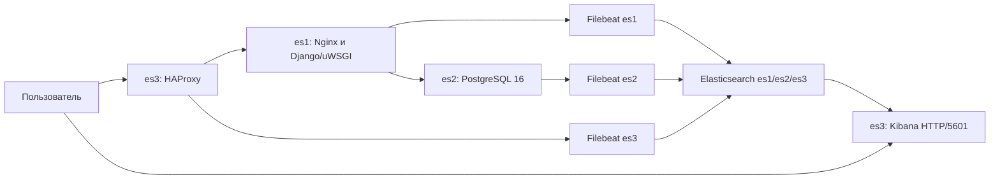

# ДЗ07 — централизованный сбор логов в Elasticsearch

Цель — отказоустойчивое хранение журналов серверов и визуализация для диагностики.
Реализован кластер Elasticsearch 8.19.0 из трёх узлов в Selectel, сбор через
Filebeat и просмотр в Kibana. Логи собираются только с серверов этого проекта.
Исходники приложения и инфраструктурные подходы переиспользованы из ДЗ01–ДЗ06;
работающие стенды предыдущих заданий не требуются.

## Архитектура



| ВМ | Дополнительные сервисы | Ресурсы | Диск |
| --- | --- | --- | --- |
| es1 | Nginx, Django/uWSGI | 2 vCPU, 8 ГиБ RAM | 20 ГиБ SSD |
| es2 | PostgreSQL 16 | 2 vCPU, 8 ГиБ RAM | 40 ГиБ SSD |
| es3 | HAProxy, Kibana | 2 vCPU, 8 ГиБ RAM | 20 ГиБ SSD |

На каждой ВМ работают Elasticsearch с ролями master/data/ingest и Filebeat.
Узлы размещаются в ru-9a на разных физических хостах посредством anti-affinity.
Одна основная копия и одна реплика индексов, большинство 2/3 для выбора master
позволяют Elasticsearch пережить потерю одной ВМ. Отказ всего ЦОД не покрывается;
приложение, база и Kibana собственных реплик не имеют.

Сеть — 10.77.0.0/16, адреса узлов — 10.77.1.10, 10.77.2.10, 10.77.3.10.
Запрос проходит HAProxy:80 → Nginx:8081 → uWSGI:8080 → PostgreSQL:5432.
Elasticsearch:9200/9300 доступен внутри группы безопасности; SSH:22 и
Kibana HTTP:5601 ограничены адресами /32 оператора. Портал доступен по HTTP:80.
Kibana слушает сетевые интерфейсы es3; вход требует авторизации. HTTP API и транспорт
Elasticsearch используют TLS и проверку собственного центра сертификации.
Filebeat имеет отдельную роль записи, Kibana использует kibana_system.

`discovery.seed_hosts` содержит три приватных адреса.
`cluster.initial_master_nodes` используется только при первом формировании
кластера, затем удаляется. Данные хранятся на дисках ВМ и удаляются вместе со стендом.

Filebeat собирает journald, журналы Elasticsearch и файлы Nginx, PostgreSQL,
HAProxy. Очередь на диске ограничена 512 МБ; отправка распределяется между тремя
HTTPS endpoint. Шаблон `logs-otus-*` задаёт реплику; ingest pipeline классифицирует
события и разбирает Nginx. Политика жизненного цикла индексов (ILM) удаляет их
через семь дней от создания. Ежедневные индексы не используют rollover.

Filebeat выбран как агент чтения локальных журналов с собственной очередью;
отправка напрямую в три узла Elasticsearch исключает отдельный центральный
сервер сбора. Kibana использует те же индексы для поиска и отображения событий.

## Соответствие заданию

| Требование | Реализация и подтверждение |
| --- | --- |
| Три узла Elasticsearch | [Terraform Selectel](terraform-selectel/), [состояние кластера](docs/verification.json) |
| Логи web, БД и балансировщика | [Настройка серверов](scripts/remote/setup.py), Filebeat на трёх ВМ |
| Шаблоны и обработка | [Настройка Elasticsearch](scripts/remote/api.py), pipeline, ILM, шаблон индекса |
| Поступление логов | [Примеры событий](docs/verification.json), [HTTP-проверки](docs/http-check.json) |
| Визуализация | [Kibana и дашборд](docs/kibana.json) |
| Отказоустойчивость | [Отказ master](docs/failover.json), [восстановление](docs/recovery.json) |

## Запуск и проверка

Все команды выполняются по очереди локально в PowerShell из корня репозитория.
Однократная [подготовка окружения](docs/operations.md) описывает Python,
Terraform, собственный проект Selectel и права оператора. Подготовленный каталог
содержит `.tools/venv/Scripts/python.exe` и `.tools/terraform.exe`;
альтернативный путь Terraform задаётся через `OTUS_TERRAFORM`.

```powershell
# Ввести credentials
. .\scripts\env.ps1

# Развернуть
.\.tools\venv\Scripts\python.exe scripts/lab.py deploy
if ($LASTEXITCODE -ne 0) { throw 'Развёртывание не выполнено; выполнить destroy' }

# Проверить приложение, отказы и восстановление
.\.tools\venv\Scripts\python.exe scripts/lab.py verify
if ($LASTEXITCODE -ne 0) { throw 'Проверка не пройдена; выполнить destroy' }

# Получить адрес портала и открыть браузер
$lab = Get-Content .\.local\lab.json -Raw | ConvertFrom-Json
$portalUrl = 'http://' + $lab.es3.public_ip
$portalUrl
Start-Process $portalUrl

# Открыть Kibana без SSH-туннеля
$kibanaUrl = 'http://' + $lab.es3.public_ip + ':5601'
$kibanaUrl
Start-Process $kibanaUrl
```

Реквизиты остаются только в окружении текущей сессии PowerShell; файл
для deploy, verify и destroy не требуется. После проверки портала в браузере:

```powershell
# Удалить и подтвердить отсутствие ресурсов — также выполнить при ошибке deploy или verify
.\.tools\venv\Scripts\python.exe scripts/lab.py destroy
if ($LASTEXITCODE -ne 0) { throw 'Удаление не подтверждено; сохранить state, контекст и ключи для повторной очистки' }

# Удалить все реквизиты из окружения текущей сессии
. .\scripts\env.ps1 -Clear
```

Ожидаются `APPLICATION READY` после deploy, `LIVE VERIFICATION PASSED` после
verify и `DESTROY CONFIRMED` после destroy. deploy создаёт платные ресурсы
и оставляет сервисы работающими. verify временно выключает текущую ВМ master
Elasticsearch, проверяет чтение/запись при отказе, возвращает три узла и green,
повторно проверяет приложение и сбор логов. После успеха стенд продолжает работать.
При ошибке создания или проверки вызывается удаление; после остановки процесса
или потери питания требуется ручной destroy. Подробности и восстановление
после ошибок — в [инструкции](docs/operations.md).

destroy необратимо удаляет ВМ, данные, диски и IP. Простая остановка ВМ
сохраняет диски и расходы. При ошибке удаления сохраняются state, контекст и
ключи; реквизиты можно повторно ввести в новой сессии PowerShell.

## Подтверждённые результаты

Отчёты фиксируют завершённую облачную проверку с последующим удалением стенда.
Ожидаемое поведение команд приведено выше.

| Проверка | Проверяемое поведение | Подтверждённый результат |
| --- | --- | --- |
| Кластер | Три узла и реплики | 3 узла, green, 0 unassigned shards |
| Сбор | События всех источников | 8876 событий пяти источников |
| Обработка | Разбор Nginx | 36 событий с HTTP status |
| Приложение | HTTP через HAProxy | `/` и `/health/ready` — 200, отсутствующий URL — 404 |
| Kibana | Доступность и отображение | available, data view и dashboard `otus-logs` |
| Отказ | Работа ES без master es2 | master es3, прежний документ сохранён, новая запись прочитана |
| Восстановление | Полный кластер | 3 узла, green, оба проверочных документа сохранены |
| Очистка | Отсутствие ресурсов | [Selectel](docs/selectel-cleanup.json), [YC](docs/yc-cleanup.json), [статус](docs/status.json) |

## Доступ и ограничения

Адрес es3 сохраняется после развёртывания в `.local/lab.json`.

| Сервис | Адрес | Доступ |
| --- | --- | --- |
| Портал | `http://<public-IP-es3>:80` | Публичное чтение |
| Kibana | `http://<public-IP-es3>:5601` | Разрешённые /32 оператора и вход по паролю |
| SSH | `<public-IP-узла>:22` | Разрешённые /32 оператора и ключ |

При необходимости подключиться к серверу:

```powershell
ssh -p 22 -i .local/otus_dz07 -o UserKnownHostsFile=.local/known_hosts -o StrictHostKeyChecking=yes otus@<public-IP-es3>
```

В Kibana используется пользователь `elastic`, пароль из
`.local/secrets.json`. Представление `logs-otus-*` использует `@timestamp`;
дашборд «OTUS DZ07 — журналы серверов» содержит таблицу логов.
HTTP не шифрует пароль Kibana и содержимое журналов; такой доступ предназначен
для временного учебного стенда с ограничением по IP. Elasticsearch сохраняет TLS.
HTTP портала предназначен для чтения; административный вход требует отдельно
защищённого соединения. Новый внешний HTTP-доступ Kibana подготовлен в конфигурации;
сохранённая облачная приёмка подтверждает внутреннюю доступность Kibana.

Совмещение сервисов и небольшие диски рассчитаны на учебную нагрузку;
заполнение дисков нужно контролировать раньше семидневного срока хранения.
Промышленный вариант требует раздельных ролей, резервирования приложения и БД,
нескольких зон и резервных копий.

Selectel выбран с учётом доступности ресурсов. Квоты YC допускают компактный
вариант, но не гарантируют доступную вычислительную ёмкость. Несколько облаков
не отменяют ограничения организации и провайдера. Подробности и источники:
[оценка YC](docs/yc-feasibility.md). Альтернативный сценарий сохранён в
[scripts/yc_lab.py](scripts/yc_lab.py); основные команды работают с Selectel.

## Структура репозитория

| Путь | Назначение |
| --- | --- |
| [scripts/lab.py](scripts/lab.py) | Основные команды жизненного цикла |
| [scripts/selectel.py](scripts/selectel.py) | Selectel API, Terraform, отказные проверки |
| [scripts/credentials.py](scripts/credentials.py) | Единый источник реквизитов для API и Terraform |
| [config/selectel.json](config/selectel.json) | Несекретная политика среды и единый перечень полей ввода |
| [scripts/yc_lab.py](scripts/yc_lab.py) | Общие SSH/TLS механизмы и вариант YC |
| [terraform-selectel/](terraform-selectel/) | Инфраструктура Selectel |
| [terraform/](terraform/) | Альтернативная инфраструктура YC |
| [scripts/remote/](scripts/remote/) | Настройка сервисов и проверки на ВМ |
| [requirements-local.txt](requirements-local.txt) | Зависимости контроллера |
| [docs/operations.md](docs/operations.md) | Подготовка и полная инструкция запуска |
| [docs/](docs/) | Результаты и примеры журналов |
| [.gitignore](.gitignore) | Исключение секретов и локальных данных |

Основной сценарий использует окружение, без сохранения реквизитов оператора.
Отдельный [режим разработки](docs/operations.md#локальный-файл-для-разработки)
допускает локальный файл с ограниченными правами; после завершения разработки
и очистки ресурсов файл удаляется. State, контекст стенда, ключи и секреты
приложения остаются локальными. В доказательства публикуются обезличенные результаты.
