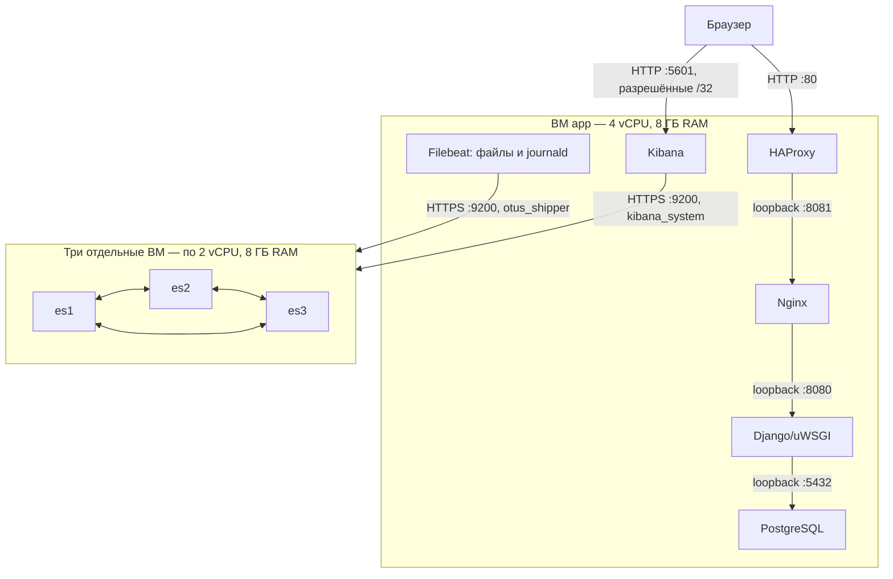
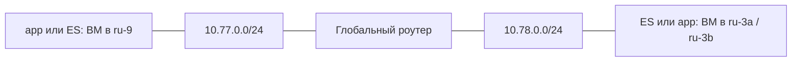

# Схема ДЗ07

Пример допустимого распределения между пулами (выбор выполняется при deploy):

Если все ВМ удалось создать в одном пуле, они используют его сеть напрямую.

Elasticsearch использует master/data/ingest на каждом узле, транспортный TLS,
HTTPS и авторизацию. В обычном режиме три ES-узла имеют обязательное разнесение по физическим
хостам. App не требует отдельного физического хоста. Discovery seed hosts
содержит три ES-адреса. `cluster.initial_master_nodes` используется только
при первом формировании и удаляется после подтверждения кластера.

HAProxy имеет один backend Nginx: это HTTP-прокси с журналированием,
без избыточности веб-слоя. Nginx и uWSGI слушают loopback; PostgreSQL также
доступна только локально. Публичный IP назначается только app, SSH — порт 22.
К внутренним ВМ подключение проходит через app.

Filebeat установлен на всех четырёх ВМ. Nginx, HAProxy, PostgreSQL и Elasticsearch
собираются из файлов; Django/uWSGI и Kibana — из journald с отдельными
`service.name`. Общий поток journald помечается `system`. Позиции чтения
и очередь Filebeat сохраняются на диске. Django пишет метод и HTTP-статус
без URL, тела запроса и пользовательских реквизитов.

Индексы `logs-otus-*` имеют одну реплику и срок хранения семь дней.
Конвейер разбирает HTTP-поля Nginx. Kibana содержит представление данных
и таблицу событий. Проверка требует события каждой службы на каждом
соответствующем узле; наличие одного общего потока system недостаточно.

БД и media находятся на диске app вне исходников. Миграции повторяемы,
постоянный маркер в БД защищает фикстуру от повторного применения.
Общая ВМ — единая точка отказа сайта, БД и визуализации. Elasticsearch
сохраняет собственный кластер из трёх ВМ. Принудительные отказы не испытываются.

Terraform и адаптер провайдера управляют размещением и сетью. Ansible получает
адреса узлов через общий контракт инфраструктуры и не вызывает API Selectel.
Межпуловая связность Selectel обеспечивается Глобальным роутером.
Для каждого использованного пула создаётся собственная подсеть; адреса ВМ
и размещение сохраняются по узлам, без общей зоны для всего стенда.
Внутри пула используется приватная сеть напрямую, между пулами — L3-маршруты.
[Последовательное размещение и восстановление](distributed-placement.md).
Перенос сети в другое облако требует своего адаптера и подтверждения возможностей;
настройка прикладных служб от способа организации связности не зависит.

Доставка разработки: приватный S3, временные HTTPS-ссылки и SHA512.
Сдача через GitHub Releases требует отдельного разрешения публикации.
Схема четырёх ВМ подтверждена [test-cycle ru-2a](ru2-test-cycle-summary.json)
с доставкой через S3. Доставка через Releases проверена локально;
облачная проверка опубликованного выпуска выполняется отдельно.

[Дополнительные эксплуатационные сценарии](optional-elasticsearch.md) позволяют
явно проверить отказ master ES с восстановлением или подключить data/ingest-узел
es4. Они не изменяют базовую схему и не входят в обычные verify и test-cycle;
после явно запрошенного расширения повторный deploy сохраняет пять ВМ.
